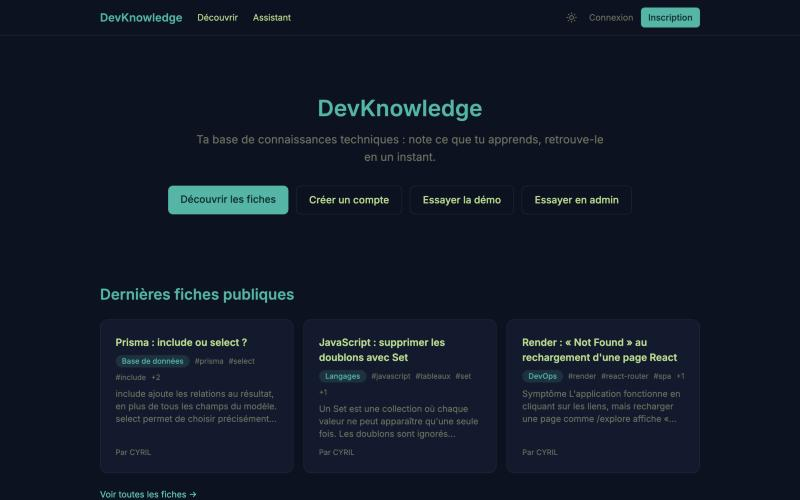
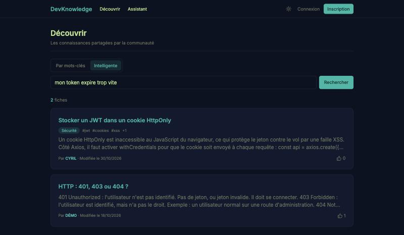
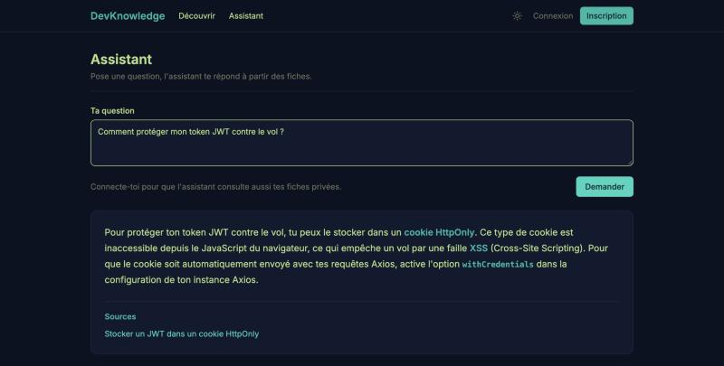
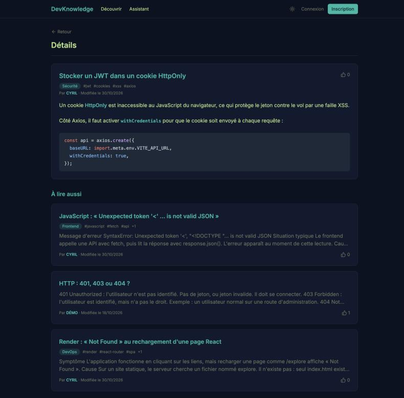
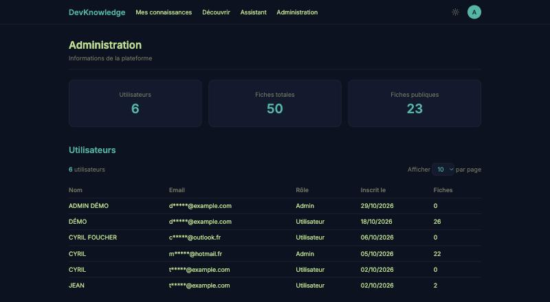

# DevKnowledge

Base de connaissances techniques, personnelle et partagée : chaque développeur y note ce qu'il apprend (une commande, une solution à un bug, un piège à éviter), en privé ou publié pour la communauté. Une IA aide à résumer, classer et retrouver les fiches, et répond aux questions à partir de leur contenu.

**🔗 Site en ligne : [knowledge-ai-zztb.onrender.com](https://knowledge-ai-zztb.onrender.com)**

**👉 Accès en un clic, sans inscription, avec les boutons « Essayer la démo » ou « Essayer en admin » de la page d'accueil.**

> L'hébergement est gratuit : au premier chargement, le serveur peut mettre 30 à 60 secondes à se réveiller.











## Fonctionnalités

- **Comptes** : inscription, connexion, modification du profil et du mot de passe, réinitialisation par email, déconnexion automatique à l'expiration de la session
- **Fiches** : création, modification, suppression, visibilité privée ou publique, contenu en Markdown avec coloration du code
- **Organisation** : catégories et tags, recherche par mots-clés, filtres, tri et pagination
- **Découvrir** : consultation des fiches publiques sans compte
- **Communauté** : favoris, « J'aime » et profils publics des auteurs
- **IA** :
  - résumé automatique d'une fiche ;
  - suggestion de tags, qui réutilise en priorité les tags déjà présents dans la base ;
  - **recherche intelligente** : une recherche comme « mon token expire trop vite » retrouve la fiche sur les JWT, même sans le mot « expire » ;
  - **fiches similaires** sous chaque fiche publique ;
  - **assistant** : une question en langage naturel reçoit une réponse rédigée uniquement à partir des fiches, avec des liens vers les fiches sources. Un utilisateur connecté interroge aussi ses fiches privées.
- **Administration** : statistiques, liste des utilisateurs, modération des fiches publiques (dépublication ou suppression, avec un motif envoyé par email à l'auteur)
- **Comptes de démonstration** : un compte utilisateur et un compte administrateur en lecture seule, avec les emails des membres masqués

## Technologies

| Domaine         | Outils                                                                                         |
| --------------- | ---------------------------------------------------------------------------------------------- |
| Frontend        | React 19, TypeScript, Vite, React Router, Tailwind CSS, React Hook Form, Zod, React Markdown   |
| Backend         | Node.js, Express 5, TypeScript, Zod, JWT, bcrypt                                               |
| Base de données | PostgreSQL (Aiven), Prisma 7, pgvector                                                         |
| IA              | API Mistral : génération de texte, sorties JSON structurées, embeddings                        |
| Emails          | Brevo (API HTTP)                                                                               |
| Qualité         | Vitest, Supertest, ESLint                                                                      |
| Déploiement     | Docker, Docker Compose, GitHub Actions, Render                                                 |

## Choix techniques

### Sécurité et fiabilité

- **Authentification par cookie HttpOnly** : le jeton JWT est inaccessible au JavaScript du navigateur, ce qui le protège en cas de faille XSS.
- **Validation systématique côté serveur** avec Zod, même quand le frontend valide déjà.
- **Droits d'accès stricts** : une fiche privée n'est visible que par son auteur, y compris pour un administrateur. Une fiche privée d'un autre renvoie 404, pour ne pas révéler son existence.
- **Aucune donnée sensible exposée** : chaque requête Prisma sélectionne explicitement les champs renvoyés.
- **Limite d'appels à l'IA** par utilisateur, et par adresse IP pour les visiteurs et la démo. Derrière les proxys de l'hébergeur, Express est configuré pour retrouver la vraie adresse du visiteur.
- **Emails en arrière-plan**, avec délai maximal : une panne du service d'emails ne bloque jamais l'application.
- **Performances** : les états « favori » et « J'aime » d'une liste de fiches sont chargés en deux requêtes groupées, au lieu d'une par fiche, et les pages du frontend sont chargées à la demande.
- **Déploiement continu** : chaque `git push` sur `main` lance la CI (compilation, lint, tests), et Render ne déploie que si elle réussit.

### Intelligence artificielle

- **Embeddings dans PostgreSQL** : chaque fiche est transformée en un vecteur de 1024 nombres qui représente son sens, stocké avec l'extension pgvector. Prisma ne gérant pas ce type, les requêtes vectorielles sont écrites en SQL paramétré, à l'abri des injections.
- **Seuil de pertinence relatif** : les distances entre une recherche et les fiches étant très proches, un seuil fixe ne convient pas. Seules les fiches proches de la meilleure sont retenues.
- **Fiches similaires sans appel à l'IA** : les vecteurs déjà stockés sont comparés directement dans PostgreSQL.
- **Assistant RAG** (*Retrieval-Augmented Generation*) : les fiches les plus pertinentes sont retrouvées par leurs vecteurs, puis transmises au modèle avec la consigne de répondre uniquement à partir de leur contenu et d'indiquer les fiches utilisées.
- **Réponses de l'IA vérifiées** : l'IA renvoie du JSON imposé par un schéma, puis contrôlé par Zod avant toute utilisation. Une réponse non conforme est rejetée au lieu d'être affichée.
- **Protection contre l'injection de prompt** : le contenu des fiches, écrit par les utilisateurs, est présenté au modèle comme une donnée à lire, jamais comme une consigne.
- **Modèle adapté à chaque tâche** : un petit modèle pour les résumés et les tags, un modèle plus capable pour l'assistant, qui doit suivre des consignes strictes. Chacun a son propre quota d'appels.
- **Pannes de l'IA sans impact** : si l'IA ne répond pas, la fiche est quand même enregistrée, et un script complète plus tard les vecteurs manquants.

## Lancer le projet en local

### Avec Docker (recommandé)

Prérequis : [Docker Desktop](https://www.docker.com/products/docker-desktop/).

```bash
git clone https://github.com/cyrilfoucher/knowledge-ai.git
cd knowledge-ai
docker compose up --build
```

L'application est disponible sur **http://localhost:8080**. La base PostgreSQL, avec l'extension pgvector, est créée, les migrations appliquées et des données de démonstration chargées automatiquement.

Comptes de démonstration (mot de passe : `demo-password`) :

- `demo@example.com` : utilisateur
- `admin@example.com` : administrateur

Les fonctionnalités d'IA nécessitent une clé API Mistral. Pour les activer, lance Docker avec ta clé :

```bash
MISTRAL_API_KEY=ta-cle docker compose up --build
```

Sans clé, l'application fonctionne entièrement, sauf l'IA.

Pour tout remettre à zéro : `docker compose down -v`.

### Sans Docker

Prérequis : Node.js 24 et une base PostgreSQL avec l'extension pgvector.

```bash
# Backend
cd backend
cp .env.example .env   # puis compléter les variables
npm install
npx prisma migrate deploy
npm run dev

# Frontend (dans un second terminal)
cd frontend
npm install
npm run dev
```

Pour calculer les vecteurs des fiches déjà présentes en base, sans en recalculer aucune déjà traitée :

```bash
cd backend
npx tsx src/scripts/backfillEmbeddings.ts
```

## Tests

```bash
cd backend
npm test
```

## Auteur

**Cyril Foucher** — en reconversion vers le développement web.

[GitHub](https://github.com/cyrilfoucher) · [LinkedIn](https://www.linkedin.com/in/cyril-foucher-a06a19236/)
