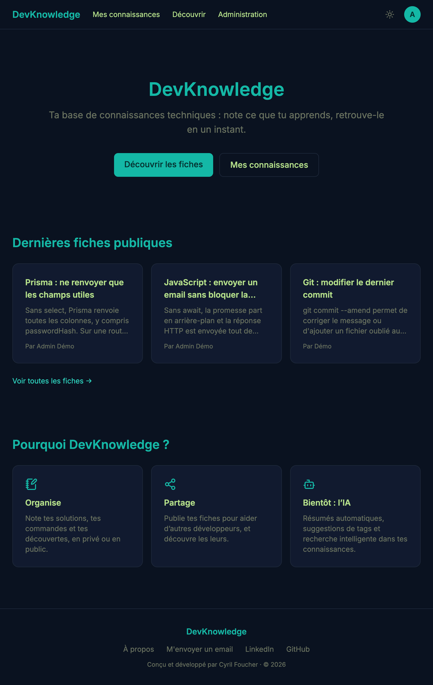
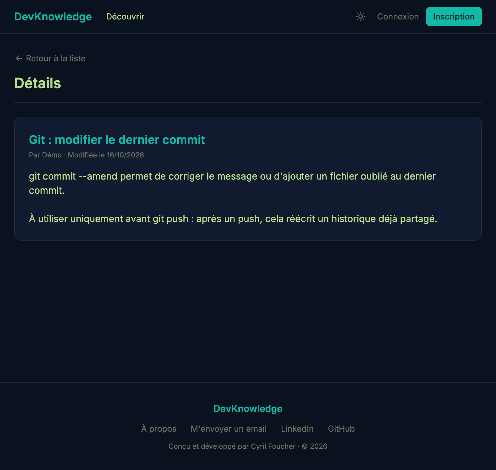
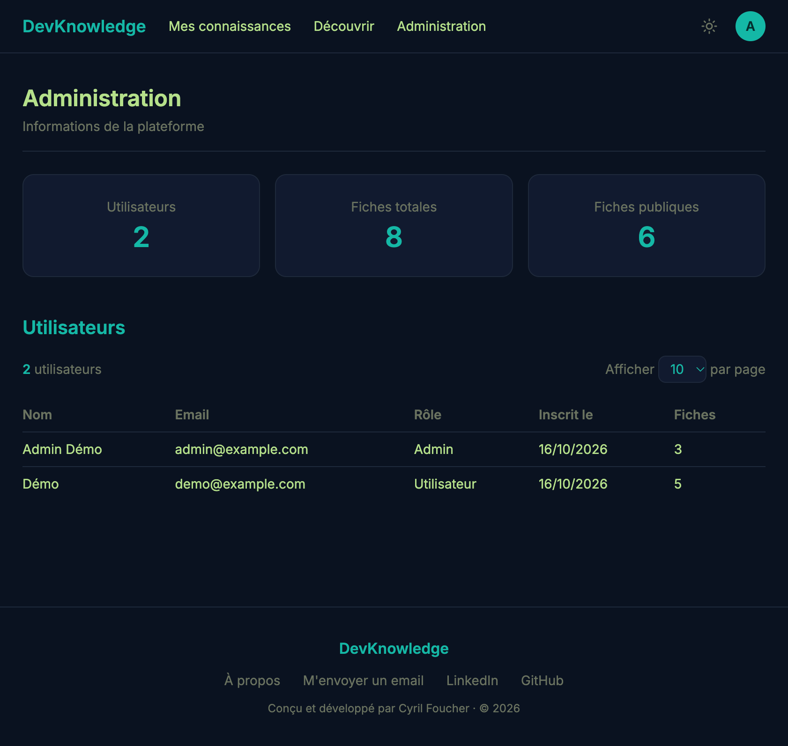

# DevKnowledge

Base de connaissances techniques, personnelle et partagée : chaque développeur y note ce qu'il apprend (une commande, une solution à un bug, un piège à éviter), en privé ou publié pour la communauté.

**🔗 Site en ligne : [knowledge-ai-zztb.onrender.com](https://knowledge-ai-zztb.onrender.com)**

**👉 Accès en un clic avec le bouton « Essayer la démo » sur la page d'accueil**, sans inscription.

> L'hébergement est gratuit : au premier chargement, le serveur peut mettre 30 à 60 secondes à se réveiller.







## Fonctionnalités

- **Comptes** : inscription, connexion, modification du profil et du mot de passe, réinitialisation par email
- **Fiches** : création, modification, suppression, visibilité privée ou publique
- **Découvrir** : consultation des fiches publiques sans compte, avec pagination
- **Administration** : statistiques, liste des utilisateurs, modération des fiches publiques (dépublication ou suppression, avec un motif envoyé par email à l'auteur)
- **Compte de démonstration** : connexion en un clic, protégé contre la modification de son email et de son mot de passe

## Technologies

| Domaine         | Outils                                                                       |
| --------------- | ---------------------------------------------------------------------------- |
| Frontend        | React 19, TypeScript, Vite, React Router, Tailwind CSS, React Hook Form, Zod |
| Backend         | Node.js, Express 5, TypeScript, Zod, JWT, bcrypt                             |
| Base de données | PostgreSQL (Aiven), Prisma 7                                                 |
| Emails          | Brevo (API HTTP)                                                             |
| Qualité         | Vitest, Supertest, ESLint                                                    |
| Déploiement     | Docker, Docker Compose, GitHub Actions, Render                               |

## Choix techniques

- **Authentification par cookie HttpOnly** : le jeton JWT est inaccessible au JavaScript du navigateur, ce qui le protège en cas de faille XSS.
- **Validation systématique côté serveur** avec Zod, même quand le frontend valide déjà.
- **Droits d'accès stricts** : une fiche privée n'est visible que par son auteur, y compris pour un administrateur. Une fiche privée d'un autre renvoie 404, pour ne pas révéler son existence.
- **Aucune donnée sensible exposée** : chaque requête Prisma sélectionne explicitement les champs renvoyés.
- **Emails en arrière-plan**, avec délai maximal : une panne du service d'emails ne bloque jamais l'application.
- **Déploiement continu** : chaque `git push` sur `main` lance la CI (compilation, lint, tests), et Render ne déploie que si elle réussit.

## Lancer le projet en local

### Avec Docker (recommandé)

Prérequis : [Docker Desktop](https://www.docker.com/products/docker-desktop/).

```bash
git clone https://github.com/cyrilfoucher/knowledge-ai.git
cd knowledge-ai
docker compose up --build
```

L'application est disponible sur **http://localhost:8080**. La base PostgreSQL est créée, les migrations appliquées et des données de démonstration chargées automatiquement.

Comptes de démonstration (mot de passe : `demo-password`) :

- `demo@example.com` : utilisateur
- `admin@example.com` : administrateur

Pour tout remettre à zéro : `docker compose down -v`.

### Sans Docker

Prérequis : Node.js 24 et une base PostgreSQL.

```bash
# Backend
cd backend
cp .env.example .env   # puis compléter les variables
npm install
npx prisma migrate deploy
npm run dev

# Frontend (dans un second terminal)
cd frontend
npm install
npm run dev
```

## Tests

```bash
cd backend
npm test
```

## Feuille de route

- [ ] Catégories et tags
- [ ] Recherche, filtres et tri
- [ ] IA : résumé automatique et suggestion de tags
- [ ] Favoris, likes, profil public, signalement
- [ ] Recherche intelligente par le sens (RAG avec pgvector)

## Auteur

**Cyril Foucher** — en reconversion vers le développement web.

[GitHub](https://github.com/cyrilfoucher) · [LinkedIn](https://www.linkedin.com/in/cyril-foucher-a06a19236/)
